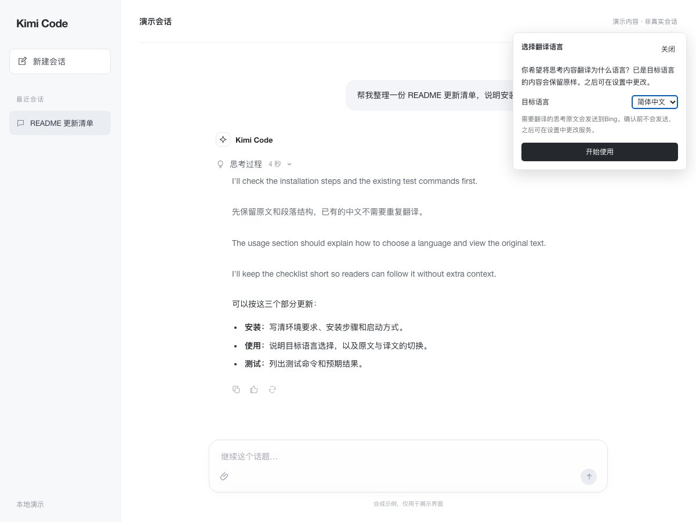
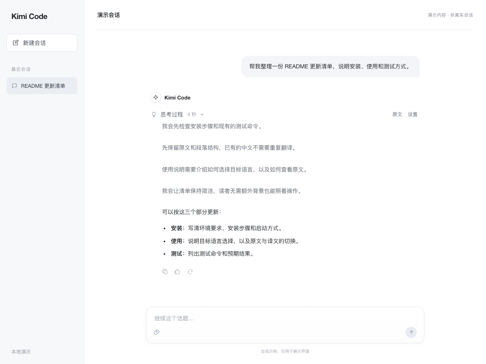

# kimi-cot-translate（kct）

[](https://github.com/wssz527/kimi-cot-translate/actions/workflows/tests.yml)

**[English](README.en.md)**

> **非官方声明**：本项目是独立开发的实验性社区扩展，与 Moonshot AI、Microsoft、Google 无隶属或背书关系。Kimi、Kimi Code 是其各自所有者的商标，此处仅用于说明互操作对象。
>
> **Unofficial community project.** Not affiliated with, endorsed by, or sponsored by Moonshot AI. "Kimi" and "Kimi Code" are trademarks of their respective owners.

为 Kimi Code 已公开的思考内容添加翻译：桌面端内嵌显示，另提供 ACP 翻译终端、浏览器扩展与 VS Code 复制预览。桌面端首次展开时选择目标语言，之后自动翻译，在原位置切换「原文 / 译文」；会话文件和模型上下文保留原文。

这是非官方的实验性运行时扩展。它不修改、重签官方 App，也不接管官方更新器。仓库不包含 Kimi Code、会话数据、密钥或翻译缓存。

| 平台 | 状态 | 当前验证版本 |
| --- | --- | --- |
| 桌面端 macOS Apple Silicon | 已验证真实翻译、启动恢复、页面刷新恢复 | Kimi Code 1.1.2 / 1.1.1 / Electron 43.1.1 |
| 桌面端 Windows x64 | 预览适配，CI runner 已验证挂载与安全停用 | 同上 |
| CLI / 浏览器扩展 / VS Code | 预览（各入口验证边界见下表） | CLI 2.1.1 / Chromium MV3 |

**按「现状」提供，不含任何担保；可能随宿主更新失效。** 详见[免责声明](#免责声明)与[已知限制](#已知限制)。

## 目录

- [使用展示](#使用展示)
- [获取与安装](#获取与安装)
  - [桌面端 macOS](#macos)
  - [桌面端 Windows（预览）](#windows预览)
  - [其它入口（CLI / 浏览器 / VS Code）](#其它入口预览)
- [桌面版使用和隐私](#桌面版使用和隐私)
- [数据离开本机的清单](#数据离开本机的清单)
- [检查、停用与卸载](#检查停用与卸载)
- [Kimi 更新后的行为](#kimi-更新后的行为)
- [已知限制](#已知限制)
- [免责声明](#免责声明)
- [本地检查](#本地检查)

## 使用展示

首次展开思考时选择目标语言，点击「开始使用」后保存。支持简体中文、English、日本語、한국어、Español、Français、Deutsch、Русский，之后可在「设置」中更改。



中英文混合的思考只翻译需要的部分，保留中文、代码块和段落间隔；点「原文」可随时查看原始内容。



以上是运行真实扩展脚本的合成演示界面（`docs/demo.html`，SYNTHETIC DEMO），翻译响应为模拟数据，不是官方 App 截图，也不包含真实用户会话。

## 获取与安装

从 [GitHub Releases](https://github.com/wssz527/kimi-cot-translate/releases) 下载最新版本的 `kimi-cot-translate-v*.zip`，解压后先校验：

```sh
shasum -a 256 -c SHA256SUMS.txt
```

然后解压进入目录。也可以 `git clone` 本仓库（浏览器扩展与 VS Code 产物需 `npm ci && npm run build:browser && npm run build:vscode` 自行构建；Release 附件已包含预构建产物）。

安装只设置扩展的后台加载器，不会强制退出或重启 Kimi，也不修改官方安装包。首次安装会向符合校验条件的现有进程加载翻译界面。更新扩展时，已经加载旧脚本的页面在下次正常刷新或重开后使用新版，安装命令不会擅自刷新页面。

机器需要先安装对应架构的 Node.js 24。执行安装前，建议先阅读 `runtime.mjs` 的校验流程（签名 → 内核哈希 → inspector fuse → 渲染结构）。

### macOS

解压后在系统终端进入本目录，确认 `node --version` 为 `v24.x`，执行：

```sh
node runtime.mjs --install
```

安装会校验官方 App，并把四个运行文件复制到当前用户的持久目录：

```text
~/Library/Application Support/kimi-cot-translate/
```

后台任务位于：

```text
~/Library/LaunchAgents/com.user.kimi-cot-translate.runtime.plist
```

登录时运行一次，之后只在 Kimi Code 的用户数据目录发生变化（即 Kimi 正在运行）时被唤醒。正常打开 Kimi Code 后，通常十几秒内自动挂载。Kimi 关闭后该目录静止，后台任务完全不被唤醒：不轮询、不驻留、不联网。加载器不会启动或退出 Kimi，也不会创建第二个 Kimi 应用。

运行副本独立于解压目录，安装后移动源码不会影响它。后台任务使用安装时 Node 的绝对路径；如果移除或移动该 Node，请重新执行安装命令。

### Windows（预览）

在 PowerShell 进入本仓库目录，执行：

```powershell
node runtime-windows.mjs --install
```

Windows 的静态证据、动态测试和运行约束见 [Windows 适配记录](docs/windows.md)。后台使用当前用户的登录计划任务观察现有实例，不会自行启动 Kimi；停用会等待本次挂载收尾，不终止 Kimi。重复安装只保留当前及上一份完整扩展副本，不会无限堆积旧版本。

测试环境是 GitHub Windows runner，不能代替所有 Windows 10/11 桌面、管理员权限组合和官方升级验收。

## 其它入口（预览）

| 入口 | 提供的能力 | 验证范围 |
| --- | --- | --- |
| Kimi Code CLI | 使用官方 `kimi acp` 的独立翻译终端，可交互提问或单次运行 | macOS CLI 2.1.1、实际模型和 Bing 翻译；确认译文不进入官方会话，正常退出与取消通过 |
| Kimi Code Web | 浏览器扩展在已展开的思考正文后显示译文 | 官方 2.1.1 真实会话、Chromium MV3、实际模型与 Bing 中文/日文翻译，新会话跳转通过 |
| kimi.com 聊天页 | 浏览器扩展使用该产品独立的思考区选择器 | 公开前端结构、合成页面；**尚未在登录会话验收** |
| VS Code | 用户主动复制思考后，在本扩展的独立预览内选择语言、翻译和切换原文 | 共享引擎、Chromium 消息与 CSP 测试、VSIX 打包；尚未在真实扩展宿主验收 |

CLI：

```sh
node cli.mjs --target zh
# 单次运行：
node cli.mjs --target zh --prompt "解释当前项目，先不要修改文件。"
```

CLI 翻译终端不修改原生全屏 TUI，工具审批会显示并等待选择；非交互运行不会自动批准发来的审批请求。详见 [CLI 运行与数据说明](docs/cli.md)。

浏览器（Release 附件 `kct-browser-v*.zip` 为预构建产物，可跳过构建）：

```sh
npm run build:browser
```

在 Chromium 扩展管理页选择“加载已解压的扩展程序”，指向 `browser/dist/`。展开思考，选择并确认目标语言，然后点击翻译。Kimi Code Web（`kimi web` 本机界面）和 kimi.com（普通聊天页）是两个不同产品，使用不同的结构适配，默认不自动发送文本；详见 [浏览器安装和验证记录](docs/browser.md)。

VS Code（Release 附件 `kct-copied-thinking-*.vsix` 可直接安装）：

```sh
npm run build:vscode
code --extensionDevelopmentPath="$PWD/vscode"
```

复制需要翻译的思考，打开命令面板运行 `KCT: Preview and Translate Copied Thinking`，在预览中审阅并确认后翻译。官方 Kimi 扩展没有公开思考面板接入点，因此这个入口不自动跟随官方面板。本扩展不上架 VS Code Marketplace，仅通过 Release 的 VSIX 分发。详见 [VS Code 安装、打包和接口核查](docs/vscode.md)。

这些预览入口复用同一翻译引擎，支持八种目标语言。CLI 可选 Bing 或 Google；浏览器和 VS Code 预览目前使用 Bing。各入口的设置与存储边界分别记录在对应文档中。

## 桌面版使用和隐私

- 首次展开「思考过程」时选择目标语言并确认；确认前不发送翻译请求。旧设置如果是「跟随 Kimi 界面」，也会提示选择一次；已经明确选择过语言的用户保持原设置。
- 点「原文 / 译文」切换；点「设置」选择目标语言、服务和自动翻译。
- 折叠区块不请求翻译；失败保留原文，可点「重试」。
- 流式内容按已完成段落增量翻译；本地能识别为目标语言的句子和段落跳过请求。代码块、行内代码与 URL 保留原文，不发送翻译。
- 整段无需翻译时保留原来的显示节点，不隐藏原文或另建一份；翻译服务原样返回时也采用相同行为，避免文字位置变化。

语言判断在本地进行，不下载额外模型。中文、日文、韩文结合文字特征判断，英文、西班牙文、法文、德文、俄文还比较常见词；短句或混合语言判断不明确时，仍交给所选服务翻译，避免误跳过外语内容。这不是完整的语言识别模型，不能保证每条同语种短句都免请求。

默认服务是 Bing。Bing 和 Google 都是联网服务，不在本地执行翻译：待翻译的思考文本会发送到对应第三方端点。Bing 使用批量请求、最多 3 个并发和 15 秒请求超时。Google 公开端点可能受浏览器 CORS 规则限制，未作为默认服务。

**分享扩展不会共享作者的账号或权限。** Bing 和 Google 不要求配置作者的账号或 API key，请求明确设置 `credentials: 'omit'`，不携带浏览器 Cookie 或登录凭据。其他人安装后使用自己的网络，在自己的电脑上保存设置和缓存。公共端点仍可能限流，当前可用不代表官方提供稳定的扩展接口。

设置和译文缓存保存在 Kimi 的 localStorage。自定义 OpenAI 兼容服务需要用户自行填写端点和 API key，只向所填端点发送该 key；key 保存在本机 localStorage，未加密。分享仓库或干净的源码包即可，请勿分享整个 Kimi 用户数据目录或这些存储数据。

**开启前请注意**：思考链中常包含代码、路径、内部标识甚至凭据。请不要在含密钥、客户数据或机密内容的会话中开启自动翻译；发送前请自行确认内容可以离开本机。

### 缓存会不会一直变大？

译文缓存同时受以下限制，达到任一限制都会清理：

- 最多 500 条，超过时淘汰最近最少使用的条目。
- 序列化 JSON 最多 2 MiB，按 UTF-16 字节计算，包含 key 和时间戳。
- 条目 7 天未使用后过期；页面运行时由单个到期计时器清理，启动和读写时也会检查。

缓存按文本 hash 复用，不绑定会话。离开一个会话不会立刻删除所有已翻译条目，但闲置条目会过期，数量和容量始终受限。旧版无时间戳缓存的 7 天窗口从首次迁移时开始；损坏或已经超出预算的旧缓存会清空。

离开会话、折叠或替换思考内容时，失效的排队任务会取消。已经发出的请求可能继续到完成或 15 秒超时，但不会把失效结果写回缓存。点设置中的「清空缓存」后，清空之前发出的请求也不会重新填入缓存。

这里只处理翻译层译文和临时任务，不删除 Kimi 的聊天历史、原文或设置。上述容量是译文缓存预算，不是 Kimi 整个进程的内存上限。

## 数据离开本机的清单

| 内容 | 发往 | 时机 | 如何关闭 |
| --- | --- | --- | --- |
| 待翻译的思考文本（代码块/URL 除外） | 用户选择的翻译端点（默认 `edge.microsoft.com`） | 确认语言后展开思考或点「翻译」 | 关闭自动翻译 / 不点翻译 / `--disable` |
| 自定义服务 API key | 仅用户自填的端点（`Authorization: Bearer`） | 仅在使用自定义服务翻译时 | 清空设置中的 key |
| 设置与译文缓存 | 不离开本机（localStorage） | — | 设置中「清空缓存」 |

诊断记录（`runtime-state.json`、`runtime.log`）不包含会话正文或服务密钥。浏览器扩展不保存 `#token=`，也不读取任何会话接口。

## 检查、停用与卸载

macOS：

```sh
node "$HOME/Library/Application Support/kimi-cot-translate/runtime.mjs" --check
```

Windows 在本仓库目录执行：

```powershell
node runtime-windows.mjs --check
```

状态是最近一次后台检查的记录：

- `active`、`loaded: 1`、`inspectorClosed: true`：所记录的 PID 已完成挂载，调试接口已关闭。
- `waiting`：等待正常实例启动，或等待多个实例、端口占用等条件解除。
- `error`：校验或挂载失败，读取 `detail`；瞬时失败会退避后自动重试，永久不兼容（未知哈希/签名不符）不会重试。
- `blocked-inspector`：调试接口未能确认关闭，请正常退出 Kimi，再查看日志。

状态保存在对应用户数据目录的 `runtime-state.json`，macOS 另有 `runtime.log`。Windows 数据目录为 `%LOCALAPPDATA%\kimi-cot-translate\windows`。这些诊断记录不包含会话正文或服务密钥。

停止后续自动加载（即卸载的运行时部分）：

```sh
# macOS
node "$HOME/Library/Application Support/kimi-cot-translate/runtime.mjs" --disable
```

```powershell
# Windows，在本仓库目录执行
node runtime-windows.mjs --disable
```

已加载的翻译层在下次正常退出 Kimi 时消失。停用不会强行结束会话；需要重新启用时再次执行安装命令。彻底卸载：执行 `--disable` 后删除上述持久目录与 LaunchAgent / 计划任务即可；官方 App 自始至终未被修改，无需重装。

## Kimi 更新后的行为

扩展文件位于官方 App 以外，正常 App 更新不会覆盖这些文件。新进程启动后，后台任务会重新检查签名、实际运行文件、Electron 主版本、inspector fuse 和思考区块结构，再自动挂载。

**日常跟随不需要你做任何事。** 判断能否继续用的不是版本号，而是思考区块的界面结构：

- 官方更新后如果 `.think` / `.think-head` / `.think-body` / `.think-body-inner` / `.think-text` 这五个结构仍在，且签名、调试能力、Electron 主版本都没变，翻译会直接继续工作，不必等新版、也不必重装。
- 只有这五项之一真的变了，翻译才会停用并等待适配——这才是「上游坏了、需要我修」的情况。

组件自身也会自动跟版，但**只在 Kimi Code 运行时**：每次 Kimi 启动后检查一次仓库发布的更新清单，发现新版本就下载运行时文件、逐个校验 SHA-256，通过后原子替换（失败自动回滚）。同一个 Kimi 进程不会重复检查；Kimi 关闭期间不发任何网络请求。也可以手动触发：

```sh
node runtime.mjs --update
```

停用状态会写在 `--check` 输出的 `updateStatus` / `updateVersion` 字段里（`up-to-date` / `installed` / `available` / `failed`），`updateCheckedFor` 记录已检查过的那次启动。

为什么仍然保留哈希允许列表：完全验证过的内核走快速路径，跳过额外探测。未知哈希不再直接熔断，而是转入上面的结构校验——这是「不因官方小版本升级而中断」的关键改动。

常见现象对照：

| 现象 | 可能原因 | 处理 |
| --- | --- | --- |
| 更新后翻译消失，detail 含 `reasoning UI changed` | 思考区块结构变了 | 提兼容性报告，等待适配版本 |
| detail 含 `outside the supported major` | Electron 主版本跨代 | 同上 |
| detail 含签名或结构校验失败 | 官方包结构变化 | 同上；不要手工绕过 |
| `blocked-inspector` | 调试接口未确认关闭 | 正常退出 Kimi 后查看日志 |

这不是官方承诺稳定的扩展 API，不能保证所有未来版本都兼容。当前只验证过正常重启恢复和页面刷新恢复，尚未完成真实跨版本升级验收。静态结构检查也无法证明所有新版交互都兼容。

挂载期间会短时开启仅限本机的 Node inspector（最长约 12 秒，关闭后确认端口已释放），检查所属 PID 后安装内存监听。未通过校验的内核不会收到开启 inspector 的信号。

## 已知限制

- 已验证 Kimi Code 1.1.1 与 1.1.2 / Electron 43.1.1；跨版本升级、睡眠唤醒、长期运行尚未验收。
- 不支持 Kimi 桌面端（Kimi.app，com.moonshot.kimichat）：官方在其 Electron 二进制中关闭了 Node inspector fuse，本项目的运行时注入机制在技术上无法挂载，且本项目不会通过修改官方二进制绕过。Kimi 网页版（kimi.com）用户请使用浏览器扩展入口。
- kimi.com 普通聊天页未在登录会话验收；VS Code 入口未在真实扩展宿主验收。
- 翻译使用公共免鉴权端点（Bing / Google），无 SLA，可能限流、变更或受服务方条款约束；长期或大量使用建议使用自带凭据的自定义服务。
- 自定义服务的 API key 明文保存在本机 localStorage。
- Windows 适配仅在 GitHub runner 验证，未覆盖所有 Windows 10/11 桌面环境。

## 免责声明

本扩展按「现状」提供，不含任何明示或默示担保（MIT License 含完整法律文本，见 `LICENSE`）。安装与使用即表示你自行承担风险；作者不对因宿主更新导致的失效、数据、会话或账号问题承担责任。与 Kimi Code、Moonshot AI、Microsoft、Google 无隶属或背书关系；Kimi、Kimi Code 等名称均为其各自所有者的商标。第三方归属与来源说明见 `NOTICE.md`。

## 本地检查

开发测试使用锁定的 Playwright 版本，安装运行扩展本身不需要这些依赖：

```sh
npm ci
npx playwright install chromium
npm test
npm run test:browser
npm run test:vscode
npm run test:windows
# macOS 上另执行：
npm run test:macos
```

重新生成上述演示截图（只使用合成内容和模拟响应，不调用真实翻译服务）：

```sh
node docs/create-screenshots.mjs
```

GitHub Actions 运行共享 UI、hook、ACP 协议、浏览器、VS Code 预览和 Windows 加载器模拟回归；macOS 另运行对应的系统加载器单元测试。测试环境与具体入口的实际安装支持分别列在前面的表格中。

手动触发的 [Windows 官方 App smoke](https://github.com/wssz527/kimi-cot-translate/actions/workflows/windows-live.yml) 覆盖真实签名校验、调试触发、两个冷启动进程、挂载、接口关闭、计划任务安装不重启及安全停用；该工作流在官方安装包更新后会按设计失败（哈希熔断），需要人工完成离线兼容核查后更新哈希，**失败不代表本仓库代码损坏**。它使用未登录的全新环境，没有验证真实用户会话中的 Bing 翻译或官方升级。CI 成功不能替代这些缺失的验收。

2026-10-21 的 macOS 部署验收覆盖了真实 Bing 翻译、原文切换、正常启动后自动加载、页面刷新恢复、官方签名和资源哈希保持不变。真实升级、睡眠唤醒和长期运行尚未验证。

## 许可与贡献

MIT License（见 `LICENSE`）。贡献前请阅读 `CONTRIBUTING.md`；安全问题见 `SECURITY.md`。本项目不经 npm 分发，`package.json` 的 `private: true` 是有意为之。
